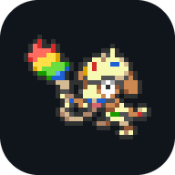
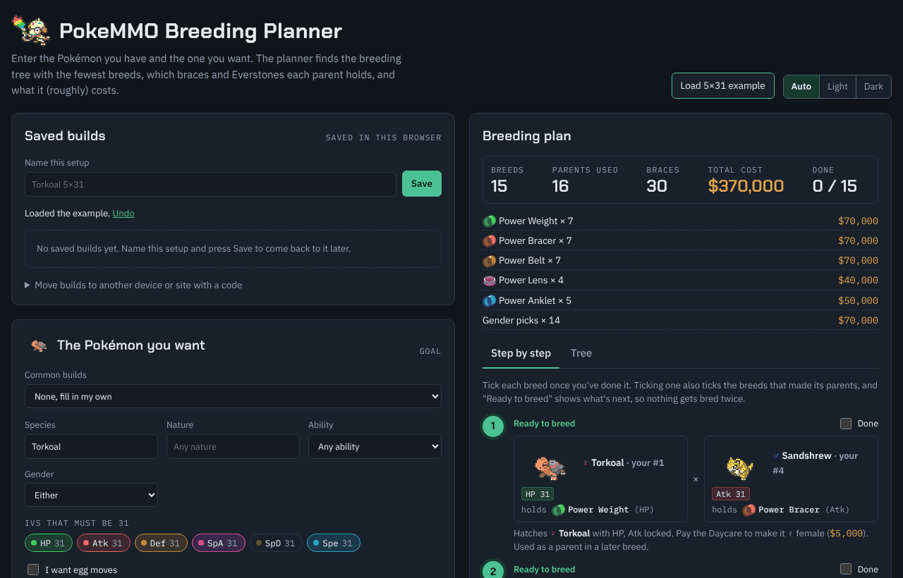

# PokeMMO Breeding Planner (Alpha)

> **Alpha.** The planner is new and still being checked against the game. Plans, rules and prices may be
> wrong in places, so double-check before spending in-game money, and please
> [report anything that looks off](https://github.com/ssmith130/PokeMMOBreeder/issues/new).

Tell it the Pokémon you have and the one you want, and it works out the breeding tree with the fewest
breeds: which parents to pair, what each one holds, which gender to pay for, and what it all costs.

**Use it at [smearguru.org](https://smearguru.org).**



## Features

- **Fewest breeds or lowest cost.** The planner tries the ways your Pokémon can be paired and picks the
  shortest plan, or the cheapest one if you'd rather.
- **Every item spelled out.** Each parent's Power item or Everstone, the gender picks, incense babies, and
  Pokémon worth buying from the GTL when yours can't make the goal on their own.
- **A cost you can trust.** Braces, Everstones, gender selection, incense, TMs and held items add up to a
  total, and every price can be changed to match the market.
- **Step by step or as a tree.** Tick breeds off as you go, and the planner shows what is ready to breed next.
  The tree pops out full screen.
- **Egg moves and TMs.** It plans who has to know each egg move, or lets you teach it with a TM instead.
- **Common builds.** Catching Breloom, Smeargle, gym re-run Typhlosion and Thief Dusknoir fill in the goal
  in one click, from their own dropdown above the goal.
- **Event builds.** A second dropdown holds builds for the current seasonal event (Halloween for now). It can
  be shown or hidden, see [Event builds](#event-builds).
- **Saved builds.** Keep several setups, and move them to another device with a code.
- **My box.** A second tab holds the Pokémon from your game in a PC box like PokeMMO's: box icons in a
  10×6 grid of 60 spots like PokeMMO's, several named boxes, alphas drawn bigger with a red outline and a blue diamond on hidden-ability Pokémon, drag to move. Hover over one to see its IVs, nature, ability and egg moves.
  Tick "Use the Pokémon in my box" and the planner breeds with them; ticking off breeds can take the parents
  out of the box and put the finished Pokémon in (unticking puts them back). The box is kept apart from saved
  builds and moves to another device with its own code. Box size is `BOX_COLS`/`BOX_ROWS` in `src/page.html`.
- **Import from PokeMMO.** Fill the box without typing: share the PokeMMO window with the page, open your PC
  and hold ← from the box's last spot to its first. Each Pokémon is read off the box's side panel as the cursor
  passes it (species, gender, IVs, nature, ability, egg moves) and lands in the same spot of a new box, after a
  check-over list. Pokémon can also be pasted as text in the Showdown / PokePaste format, and any box copied out
  as text. See [Importing from PokeMMO](#importing-from-pokemmo).
- **Works anywhere.** Phone-friendly, light and dark themes, and it can be added to your home screen like
  an app. Nothing to sign up for, and what you enter stays in your browser.

## The breeding rules it follows

- A Power item guarantees the holder's IV in its stat, and a stat both parents share at 31 always carries
  over. Other IVs are averaged, so the planner doesn't count on them.
- An Everstone passes the holder's nature and takes its item slot. Both parents are used up.
- The egg is the mother's species, or the non-Ditto parent's. The ability comes from that parent by chance
  (about 60% for a hidden ability). Egg moves come from the father.
- Incense babies (Azurill, Wynaut, Munchlax, Mime Jr., Bonsly, Budew, Chingling, Happiny, Mantyke) only
  hatch when a parent holds their incense, which takes that parent's item slot. Otherwise the egg is the
  next stage, such as Marill.
- Genderless Pokémon (Beldum, Magnemite, Bronzor and others) only breed with Ditto, and Ditto can't be bred,
  so their IVs are capped by the Dittos you have. One-gender species breed with Ditto, or with a partner
  from their egg group (Miltank with Tauros).
- Nidoran and Volbeat/Illumise eggs hatch as either species, decided by the egg's gender. When the Pokémon
  you want only comes in one gender (Vespiquen, Gallade, Nidoking), its final egg gets that gender picked.
- Gender selection costs $5k, $10k or $25k for 1:1, 3:1 or 7:1 species.

Covers all 649 Pokémon from Generations 1 to 5, as in PokeMMO.

## Run it yourself

The site is a single static page with no server code. To build and open it:

```sh
python3 build.py                        # writes dist/index.html, needs only Python 3
python3 -m http.server 8000 -d dist     # then open http://localhost:8000
```

On Windows you can double-click `start-localhost.bat` instead, which serves the site at
http://localhost:8000 using PowerShell. Opening `dist/index.html` straight from disk works too.

Every push to `main` builds the site and publishes it to GitHub Pages
(`.github/workflows/pages.yml`). To host it somewhere else or on your own domain, see
[docs/hosting.md](docs/hosting.md).

## How it's put together

| Path | What it is |
| --- | --- |
| `src/page.html` | The page: layout, styles and UI code. |
| `src/planner.js` | The breeding search. Also runs in Node: `require('./src/planner.js')`. |
| `data/species.json` | Every species' egg groups, gender ratio, abilities and egg moves. |
| `data/tms.json` | Which species can learn each TM the page offers. |
| `data/learners.json` | Which species learn each egg move by level-up, TM or tutor, for the egg move finder. |
| `data/box-icons.png` | Box icons for all 649 species, 25 per row in dex order. |
| `data/logo.png` | The Smearguru logo, painted onto Smeargle's box icon by `src/build-logo.py`. |
| `src/items.py` | The brace, Everstone and incense icons, drawn as SVG. |
| `public/` | App icons, favicons, the link-preview image and the web app manifest (redrawn by `src/build-icons.py`), and the page's fonts (`public/fonts`, under the SIL Open Font License). |
| `build.py` | Puts it all into `dist/`, along with `404.html`, `robots.txt` and `sitemap.xml`. Also writes `build/artifact.html`, a version for claude.ai. |
| `site-url.txt` | The site's address, used for link previews and the sitemap. |
| `goatcounter.txt` | Optional GoatCounter site code for visitor counts; off while it's empty. |
| `src/extract-species.js`, `src/extract-tms.js`, `src/extract-learners.js`, `src/build-sprites.py` | Regenerate the data from Pokémon Showdown and PokeAPI. |

The scripts that redraw images need Pillow; everything else needs only Python 3's standard library.

## Event builds

The event dropdown is set by `EVENT` in `src/page.html`, just after the common builds (`PRESETS`).

- **Hide or show it:** set `on: false` to hide the dropdown once the event is over, `on: true` to show it.
- **Next event:** change `label` (the dropdown's name), `banner` (the line above an event build's notes) and replace `presets`. Each build is written the same
  way as a common build. Give event builds keys of their own (the Halloween ones start with `hw-`).

Then run `python3 build.py` as usual.

## Importing from PokeMMO

The import reads the screen, not the game. The page asks the browser to share a window (as for a video call),
finds the PC box's side panel by its labels (Stats, Nature, Ability, Markings), and watches for the blue box
cursor. Each time the cursor settles on a new spot, a copy of the panel is read with
[Tesseract.js](https://github.com/naptha/tesseract.js) (open-source text recognition, about 4 MB, loaded from
jsDelivr the first time and run in the browser), and the text is matched against the site's species, natures,
abilities and egg moves. The spot comes from where the cursor was, so the direction you go doesn't matter and a
spot visited twice is just read again. The party column is left out.

In Chrome and Edge every frame of the shared window is looked at as it arrives (other browsers check about 40
times a second), so a held ← is usually fine. The page also tells filled spots from empty ones by their sprites
and level numbers, and outlines in red any it went past too fast, so you can move the cursor back onto them.

It never touches PokeMMO: no mod, nothing read from the game's memory or network traffic, and no key presses
sent to it. The player moves the cursor by hand. PokeMMO's Code of Conduct bans client modification, packet
interception and anything that automates input, so the import is built to stay clear of all three; don't pair
it with a macro or auto-clicker to step through the box.

It is tuned to the default interface theme. Alphas are picked up from the red mark in the panel's corner.
Eggs are left out, since the panel shows ??? for their IVs, nature and ability until they hatch.

## Credits

Species, move and TM data come from [Pokémon Showdown](https://github.com/smogon/pokemon-showdown), and the
box icons, including the Smeargle icon the Smearguru logo is painted on, from
[PokeAPI/sprites](https://github.com/PokeAPI/sprites). The fonts are Chakra Petch and IBM Plex, served from
this site under the SIL Open Font License. Gender selection and incense prices come from the
[PokeMMO wiki](https://pokemmo.shoutwiki.com/); the other prices are estimates you can edit.

Pokémon and its sprites are © Nintendo, Game Freak and The Pokémon Company. This is an unofficial fan
tool, not affiliated with PokeMMO.
