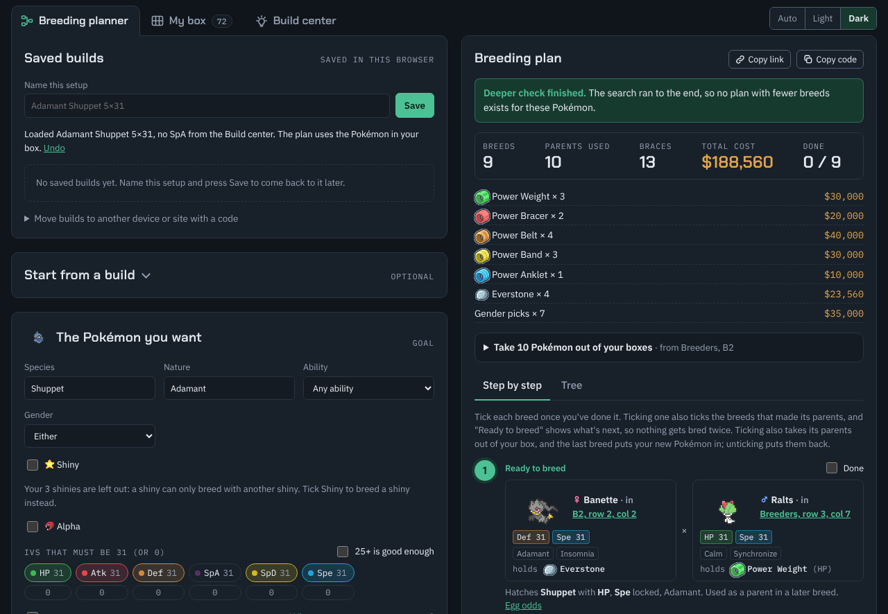

# Smearguru: PokeMMO Breeding Planner (Alpha)

> **Alpha.** The planner is new and still being checked against the game. Plans, rules and prices may be
> wrong in places, so double-check before spending in-game money, and please
> [report anything that looks off](https://github.com/ssmith130/PokeMMOBreeder/issues/new).

Tell it the Pokémon you have and the one you want, and it works out the breeding tree with the fewest
breeds: which parents to pair, what each one holds, which gender to pay for, and what it all costs.

**Use it at [smearguru.org](https://smearguru.org).**



## Features

- **Fewest breeds or lowest cost.** The planner tries the ways your Pokémon can be paired and picks the
  shortest plan, or the cheapest one if you'd rather.
- **Every item spelled out.** Each parent's Power item or Everstone, the gender picks, incense babies, and
  Pokémon worth buying from the GTL when yours can't make the goal on their own.
- **Buy parents to skip breeds.** Under "Buy parents on the GTL", tick which parents the plan may buy: 1×31, 2×31
  or 3×31, each with any nature or with your goal's nature, each with its own price (Dittos follow the "Any nature"
  ticks). 1×31 to 3×31 prices start at PikaMMO's GTL averages (about $5k, $20k, $80k); the rest are guesses.
  Shiny goals never buy parents.
- **A cost you can trust.** Braces, Everstones, gender selection, incense, TMs and held items add up to a
  total, and every price can be changed to match the market.
- **Same Pokémon, same plan.** Each plan gets a fixed amount of search work (`PLAN_WORK` in `src/page.html`, a few
  seconds on a laptop), not a number of seconds, so a big box gives the same plan on every run and every computer.
  A 40-second clock only stops a search on a very slow device, and the page says when that happened.
- **Step by step or as a tree.** Tick breeds off as you go, and the planner shows what is ready to breed next.
  The tree pops out full screen.
- **Egg moves and TMs.** It plans who has to know each egg move, or lets you teach it with a TM instead.
- **Common builds.** Catching Breloom, Smeargle, gym re-run Typhlosion and Thief Dusknoir fill in the goal
  in one click, from their own dropdown above the goal.
- **Saved builds.** Keep several setups, and move them to another device with a code.
- **My box.** A second tab holds the Pokémon from your game in a PC box like PokeMMO's: box icons in a
  10×6 grid of 60 spots like PokeMMO's (6 across on phones, so the icons stay readable), several named boxes (Delete this box asks first, then offers Undo), alphas drawn bigger with a red outline, the game's gold star on shinies and a blue diamond on hidden-ability Pokémon, drag to move. Hover over one to see its IVs, nature, ability and egg moves.
  Sort works like the game's sort menu: pick one or more of Level, Pokédex Number, 31 IV, Total IV, Gender, Egg group,
  Primary type, Catch Date and Name (the first picked decides the order, the next breaks ties, each can be flipped),
  then Sort this box or all of them, with Undo. Catch date is when a Pokémon went into the box on the site; level is
  optional (set in the editor, read off the game's panel or a "Level:" line, 1 for hatched Pokémon).
  Under the box, IV stats show the average IV total and how many Pokémon have 0×31 up to 6×31, for this box or all
  of them; Copy stats puts that on the clipboard as a few lines of text to paste in Discord.
  Tick "Use the Pokémon in my box" and the planner breeds with them; ticking off breeds can take the parents
  out of the box and put the finished Pokémon in (unticking puts them back). The box is kept apart from saved
  builds and moves to another device with its own code. Box size is `BOX_COLS`/`BOX_ROWS` in `src/page.html`.
- **Build center.** A third tab suggests builds you can breed from the Pokémon in your boxes, best first: for each
  species, the hardest goal on a ladder (Atk/SpA and Spe → HP too → 25+ Def and SpD → 4×31 → 5×31 without the unused
  attacking stat → 6×31) that the planner finds a plan for, using only your Pokémon plus braces and Everstones (buying
  parents is left to the planner tab: with buying allowed, every species reached 6×31 by buying dozens of 1×31s). Physical, special or defensive comes from the fully evolved Pokémon's Gen 5 base stats, with Huge Power and Pure
  Power doubling Attack (so Azumarill and Medicham are physical; Open in planner asks for the ability when a Pokémon
  of that line in your boxes has it).
  One card per species line: when a line is built more than one way (physical, special, defensive) and the ways
  reach different goals, the card has a tab for each. When a Pokémon of the line in your boxes has its hidden
  ability, or a Pokémon that can breed with it knows one of its egg moves, the check also tries the build with that
  ability and with the two egg moves most of your Pokémon know, and the card starts on the best version that works
  (all of them together if possible). Ability and Egg move dropdowns pick another; the card shows how likely the
  ability is to pass on. Spore isn't an egg move in the Gen 5 data (Shroomish learns it by level), so a Breloom card
  offers False Swipe instead.
  Each card has a nature dropdown (natures that suit the build first, the ones in your boxes marked); it starts
  on a fitting nature you own when the Everstone version works, and picking another re-checks the card, buying a 1×31
  with that nature if your boxes can't do it. Each card also says what the next goal up is missing. View by species or by egg group, filter, and Open in planner fills in the goal and turns on
  "Use the Pokémon in my box". Each check gets a fixed amount of planner work (not a time limit; up to four workers at once), so the same box gives the same answer on every computer, though breed counts marked "up to" can come out
  lower in the planner tab. Answers are remembered in the browser (localStorage `pokemmo-breeding-build-center-cache`)
  and only the species whose possible parents changed are checked again; bump `VERSION` in `src/builds.js` when a
  change to the checks should redo them all. Logic in `src/builds.js`.
- **Egg IV odds.** A panel under Prices works like PokeMMO's breeding window: type two parents' IVs (and what each
  holds) and it shows each stat's possible egg IVs with their odds, plus the chance an egg has everything in the
  Want column. PokeMMO copies three IVs from the parents (braced stats count among them) and gives the rest the
  parents' average, rounded down (PokeMMO Wiki, Breeding; matches the game's window), so a stat with no brace is the
  higher parent's IV 25% of the time, the average 50% and the lower 25% (20/60/20 with one brace, 12.5/75/12.5 with
  two). Shiny parents use the wiki's shiny rule. "Egg odds" under each breed of a plan fills it in from that breed.
  Logic: `Planner.eggOdds` in `src/planner.js`.
- **25+ is good enough.** A tick by the goal's IVs turns its 31s into 25s (in exact numbers). An egg never comes out
  below the lower parent, so two parents with 25+ pass 25+ on without a brace, and plans need fewer braces.
- **Links you can paste.** The tab is in the address (`#planner`, `#box`, `#builds`), so a link can open a tab and
  Back moves between tabs. "Copy link for this setup" (under Saved builds) and "Copy link" under the box make a link
  with the code after the # (`smearguru.org/#b=PMB2…` for a build, `#x=PMBX2…` for a box). A build link opens the
  build in the planner (Save keeps it, Undo goes back); a box link offers to add the box, with its name, as a new
  box. The code then leaves the address so a reload doesn't open it again. Links made on claude.ai point to the
  address in site-url.txt. A link to one full box is about 600 characters, well under Discord's 2,000.
- **Backup file.** "Download a backup" (at the bottom of every tab, and under "Fill or move your box") saves your
  boxes, saved builds, the planner's current setup and your settings (theme, sort, Build center view) as one
  `smearguru-backup-<date>.json` file. "Load a backup" asks first, then replaces what's in this browser, with Undo
  right after. Nothing goes to a server, so it works on GitHub Pages.
- **Short codes.** Build and box codes (PMB2 / PMBX2) pack each Pokémon into a few bytes rather than JSON, so a
  code for one box (about 800 characters) fits in a Discord message, which tops out at 2,000. The copy message
  says when a code is too long and Discord will send it as a file. Older PMB1 / PMBX1 codes still import, and a
  code can be pasted with the rest of the Discord message around it. Natures are stored as their place in
  `NATURES` and species as dex numbers, so that list must not be reordered.
- **Import from PokeMMO.** Fill the box without typing: share the PokeMMO window with the page, open your PC
  and go through the box a row at a time from its top-left spot. Each Pokémon is read off the box's side panel as
  the cursor reaches it (species, level, gender, IVs, nature, ability, egg moves) and lands in the same spot of
  the box on show if that box is empty (keeping any name you gave it), or else of a new box, after a check-over
  list. Pokémon can also be pasted as text in the Showdown / PokePaste format (as in Showdown, an IV left out is a 31; `? Atk`
  marks an unknown one). Rescan a box later to pick up what changed in the game. See [Importing from PokeMMO](#importing-from-pokemmo).
- **Works anywhere.** Phone-friendly, light and dark themes, and it can be added to your home screen like
  an app. Nothing to sign up for, and what you enter stays in your browser.

## The breeding rules it follows

- A Power item guarantees the holder's IV in its stat, and a stat both parents share at 31 always carries
  over. Other IVs are averaged, so the planner doesn't count on them.
- An Everstone passes the holder's nature and takes its item slot. Both parents are used up.
- The egg is the mother's species, or the non-Ditto parent's. The ability comes from that parent by chance
  (80%, or about 60% for a hidden ability; a male or genderless parent only passes it with Ditto). Egg moves
  pass from either parent, as long as the egg's species can learn them.
- Incense babies (Azurill, Wynaut, Munchlax, Mime Jr., Bonsly, Budew, Chingling, Happiny, Mantyke) only
  hatch when a parent holds their incense, which takes that parent's item slot. Otherwise the egg is the
  next stage, such as Marill.
- Genderless Pokémon (Beldum, Magnemite, Bronzor and others) breed with Ditto or with any Pokémon of their own
  line (Beldum with Metang), and Ditto can't be bred. One-gender species breed with Ditto, or with a partner
  from their egg group (Miltank with Tauros).
- Nidoran and Volbeat/Illumise eggs hatch as either species, decided by the egg's gender. When the Pokémon
  you want only comes in one gender (Vespiquen, Gallade, Nidoking), its final egg gets that gender picked.
- Gender selection costs $5k for the common gender (or either gender of a 1:1 species), and $10k or $25k for
  the rare gender of a 3:1 or 7:1 species.
- An egg is only alpha when both parents are alpha; the planner doesn't plan alphas.
- Manaphy and Phione aren't in PokeMMO, and the Torchic line has no Speed Boost there, so the species list
  leaves them out (see `src/extract-species.js`).
- A shiny can only breed with another shiny (a shiny Ditto counts), and two shinies always make a shiny egg
  (PokeMMO Wiki). So a plan is all shiny or all normal: tick Shiny on the goal and it breeds only from your
  shinies, with buying off; leave it off and your shinies are left out, so none get used up. Shiny breeds also
  pass IVs a little better than normal ones, which the planner doesn't count on.
- Costumes (Royal Charmander line from Shiny Wars 2026; Ninja Meowth, Vampire Sneasel, Pirate Gible and Pharaoh
  Riolu lines from Halloween 2026) pass to an egg of the costumed parent's own line: from the mother, the
  non-Ditto parent, or a father of the same line. Two different costumes can't breed together. No source gives
  odds, so the planner takes it to always pass. A costume goal breeds from your Pokémon in that costume (no
  buying for that side); otherwise costumed Pokémon are left out, and the Build center ignores them. The box
  shows a costumed Pokémon with the game's costumed icon and a hanger mark (PokeMMO Wiki, Costume Pokémon and
  Breeding). `data/costume-icons.png` is made by `src/build-costume-icons.py` from the PokeMMO client's costume
  layers and the species' DS icons; add a row there and to `COSTUME_ICONS` in `src/page.html` for new costumes.

Covers all 649 Pokémon from Generations 1 to 5, as in PokeMMO.

## Run it yourself

The site is a single static page with no server code. To build and open it:

```sh
python3 build.py                        # writes dist/index.html, needs only Python 3
python3 -m http.server 8000 -d dist     # then open http://localhost:8000
```

On Windows you can double-click `start-localhost.bat` instead, which serves the site at
http://localhost:8000 using PowerShell. Opening `dist/index.html` straight from disk works too.

Every push to `main` builds the site and publishes it to GitHub Pages
(`.github/workflows/pages.yml`). To host it somewhere else or on your own domain, see
[docs/hosting.md](docs/hosting.md).

## How it's put together

| Path | What it is |
| --- | --- |
| `src/page.html` | The page: layout, styles and UI code. |
| `src/planner.js` | The breeding search. Also runs in Node: `require('./src/planner.js')`. |
| `src/builds.js` | The Build center's goal ladders and suggestions, which call the planner. Also runs in Node. |
| `test/planner.test.js` | Checks for the breeding search (`node test/planner.test.js`). |
| `test/builds.test.js`, `test/builds-bench.js` | Checks for the Build center, and a timing run on a made-up box (`node test/builds-bench.js 300`). |
| `data/species.json` | Every species' types (Gen 5, so no Fairy), egg groups, gender ratio, abilities, egg moves and Gen 5 base stats. |
| `data/tms.json` | Which species can learn each TM the page offers. |
| `data/learners.json` | Which species learn each egg move by level-up, TM or tutor, for the egg move finder. |
| `data/box-icons.png` | Box icons for all 649 species, 25 per row in dex order. |
| `data/logo.png` | The Smearguru logo, painted onto Smeargle's box icon by `src/build-logo.py`. |
| `data/unknown-icon.png` | The "?" icon shown for an unknown or empty species (the sheet's own "?" at the end is no longer used). |
| `src/items.py` | The brace, Everstone and incense icons, drawn as SVG. |
| `public/` | App icons, favicons, the link-preview image and the web app manifest (redrawn by `src/build-icons.py`), and the page's fonts (`public/fonts`, under the SIL Open Font License). |
| `build.py` | Puts it all into `dist/`, along with `404.html`, `robots.txt` and `sitemap.xml`. Also writes `build/artifact.html`, a version for claude.ai. |
| `site-url.txt` | The site's address, used for link previews and the sitemap. |
| `goatcounter.txt` | Optional GoatCounter site code for visitor counts; off while it's empty. |
| `src/extract-species.js`, `src/extract-stats.js`, `src/extract-tms.js`, `src/extract-learners.js`, `src/build-sprites.py` | Regenerate the data from Pokémon Showdown and PokeAPI (run `extract-stats.js` after `extract-species.js`, which leaves the base stats out). |

The scripts that redraw images need Pillow; everything else needs only Python 3's standard library.

## Importing from PokeMMO

The import reads the screen, not the game. The page asks the browser to share a window (as for a video call),
finds the PC box's side panel by its labels (Stats, Nature, Ability, Markings), and watches for the blue box
cursor. Each time the cursor settles on a new spot, a copy of the panel is read with
[Tesseract.js](https://github.com/naptha/tesseract.js) (open-source text recognition, about 4 MB, loaded from
jsDelivr the first time and run in the browser), and the text is matched against the site's species, natures,
abilities and egg moves. The spot comes from where the cursor was, so the direction you go doesn't matter and a
spot visited twice is just read again. The party column is left out.

The page asks you to start on the box's top-left spot and go a row at a time: → along the top row, ↓ at its
end, ← back along the next row, and so on down the box, waiting for each Pokémon to show up on the page's map
before moving on. That works whether or not the cursor wraps round at the end of a row, and never takes it into
the party column. Holding a key down isn't recommended: the game's key repeat outruns the screen share and
Pokémon get skipped (in Chrome and Edge every frame of the shared window is looked at as it arrives; other
browsers check about 40 times a second). The page tells filled spots from empty ones by their sprites and level
numbers, marks the cursor's spot on its map, and outlines in red any Pokémon the cursor went past without a
read: in each row, any between the spots the cursor was seen on. Move the cursor back onto those to read them.

To fix a box after the game's box has changed (a Pokémon swapped, moved, released or put in), press **Rescan**
under the box, or "Rescan <box name>" in the import panel. Move the cursor onto just the spots that changed, or
go through the whole box; spots the cursor doesn't go to are left alone. When done, the page lists what changed
before touching anything: a different Pokémon in a spot replaces the old one, a Pokémon found in another spot of
the same box is moved there (keeping its nickname and egg moves from the site), and a spot that's now empty in the
game, with the cursor gone over it, is emptied. Untick any change that looks wrong, apply, and Undo puts it all back.

Nothing is saved or uploaded. Copies of the side panel stay in the browser's memory and are dropped when the
player reads again or closes the page; "Save what was read" downloads them as a file for a bug report, and only
when pressed. Reading text off the screen isn't perfect, so the check-over list matters, and interface mods,
themes and texture packs can make it less reliable.

It never touches PokeMMO: no mod, nothing read from the game's memory or network traffic, and no key presses
sent to it. The player moves the cursor by hand. PokeMMO's Code of Conduct bans client modification, packet
interception and anything that automates input, so the import is built to stay clear of all three; don't pair
it with a macro or auto-clicker to step through the box.

It is tuned to the default interface theme. Alphas are picked up from the red mark in the panel's corner, and shinies from the gold star in the same corner.
Eggs are left out, since the panel shows ??? for their IVs, nature and ability until they hatch.

## Credits

Species, move and TM data come from [Pokémon Showdown](https://github.com/smogon/pokemon-showdown), and the
box icons, including the Smeargle icon the Smearguru logo is painted on, from
[PokeAPI/sprites](https://github.com/PokeAPI/sprites). The fonts are Chakra Petch and IBM Plex, served from
this site under the SIL Open Font License. Gender selection, brace and incense prices come from the
[PokeMMO wiki](https://pokemmo.shoutwiki.com/), the Everstone price from the GTL in November 2026; the other
prices are estimates you can edit. The rules were checked against PokeMMO sources in November 2026.

Pokémon and its sprites are © Nintendo, Game Freak and The Pokémon Company. This is an unofficial fan
tool, not affiliated with PokeMMO.
